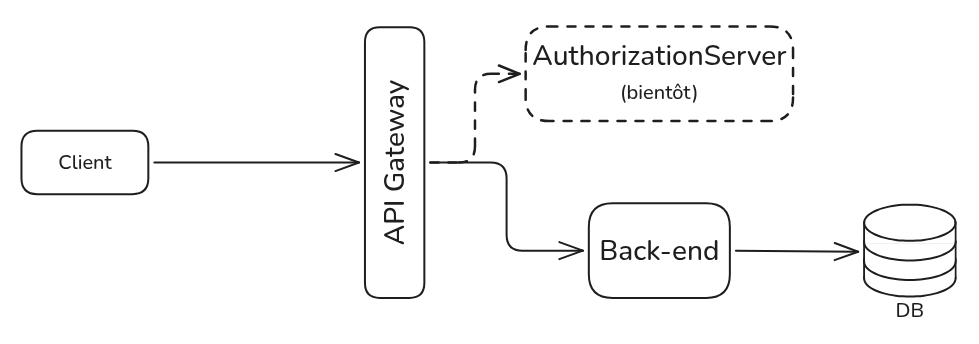

# Accounting App - Back end
## Introduction
L'Accounting App est une application en cours de développement qui a pour but d'aider la gestion des comptes et des
budgets. Ce dépôt git et cette application sont composées de plusieurs sous-projets distincts: le [front-end](front-end)
, le [back-end](back-end) et l'[API gateway](apiGateway).

L'idée est partie d'une fiche de calcul que beaucoup de personnes ont certainement fait pour gérer leur argent. Le
problème étant que ces fiches sont soit trop compliquées à mettre en place, soit trop compliquées à maintenir à cause de
leur taille.

Cette application n'a aucune vocation commerciale et ne sert pratiquement que de vitrine pour mon portefolio. Le nom de
l'application pourra changer dans le futur.

## Sous-projets et technologies utilisées

Les sous-projets se basent sur les technologies suivantes :

### Écosystème serveur :
*(commun au back-end et l'API gateway)*
- Java 25
- Spring 7
- Spring Boot 4
- JUnit 5
- Mockito

### Back-end :
- PostgreSQL
- Flyway

*Une liste exhaustive des technologies utilisées sont disponibles [ici](back-end/pom.xml).*

### API gateway
- Spring Cloud

### Front-end :
- Angular 22
- Typescript
- ViteJS
- Express

*Une liste exhaustive des technologies utilisées sont disponibles [ici](front-end/package.json).*

## Licence
Ce projet est protégé par la licence GPLv3.

[LICENCE](LICENSE)
